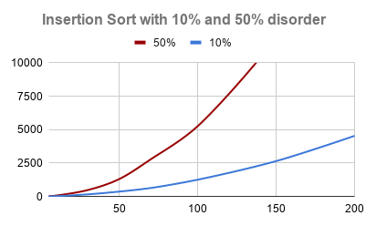

_This project has been created as part of the 42 curriculum by vldryga and arbernad._

# PUSH SWAP

## Description

The _push swap_ project aim was to create a programm that sorts sets of numbers of integer range (from -2147483648 to 2147483647) using only two stacks.

The programm takes as arguments numbers given by the user in the terminal. Then, it stores them on a stack that will be use by three algorithms of different complexity. Once the parsing of the numbers is done then, the sort starts. The algorithm's type is chosen accordingly with the flags the user gave.

### Algorithm's complexity

One the main concepts of this project is **[algorithmic complexity](https://en.wikipedia.org/wiki/Analysis_of_algorithms)** (process of finding the computational complexity of algorithms). So, it estimates the amount of time, storage and other ressources needed by the algorithm.  
To do so, the big O notation is used (mainly to describe the time or space complexity). This notation describes what is called an **asymptotic behaviour** which is an order of growth accordingly to the input. It is mostly used to compare the effeciency of algorithms. The notation provides a maximum limit that may be needed by the algorithm according to the input. The big O notation is used to ascertain the time complexity of the worst case senario.

For the simple algorithm in the O(n^2), we chosed the insertion sort adaptation.  
For the medium algorithm in the O(n√n), we chosed the bucket sort adaptation with √n buckets.
For the complex algorithm in the O(n log n), we chosed the radix sort adaptation (LSD).

### Flags description

| FLAG      | Description                                                                                                                                                                                                                                                                              |
| --------- | ---------------------------------------------------------------------------------------------------------------------------------------------------------------------------------------------------------------------------------------------------------------------------------------- |
| --simple  | Use an [Insertion Sort](https://en.wikipedia.org/wiki/Insertion_sort) method. The algorithm's time complexity is O(n^2). Space complexity is O(n).                                                                                                                                       |
| --medium  | Use a [Bucket Sort](https://en.wikipedia.org/wiki/Bucket_sort) method with √n buckets. The algorithm's time complexity is O(n√n). Space complexity is O(n).                                                                                                                              |
| --complex | Use a base 2 [LSD Radix Sort](https://en.wikipedia.org/wiki/Radix_sort) method. The algorithm's time complexity is O(n log n). Space complexity is O(n).                                                                                                                                 |
| --adaptiv | The algorithm's complexity is determined by the **disorder of the list**. If the disorder is less than 0.2 then the simple algorithm is launched, if it's less then 0.5 then the medium one is launched. And, if the disorder is bigger than 0.5 then the complex algorithm is launched. |
| --bench   | The `--bench` flag goes with or without the others. It displays the disorder, the strategy name, the total number of operations and the count of each operation.                                                                                                                         |

#### About --adaptativ thresholds

Some algorithms perform much worst or much better in worst/best case scenario.  
For instance Insertion Sort performs much better almost sorted input:  


Radix sort, on the other hand performs the same on any disorder values.  
For this reason there is little reason to use radix on almost sorted lists, or insertion sort on list with medium or high disorder.

### The operations allowed

| operations | description                                                                                            |
| ---------- | ------------------------------------------------------------------------------------------------------ |
| sa         | (swap a): Swap the first two elements at the top of stack a.                                           |
| sb         | (swap b): Swap the first two elements at the top of stack b.                                           |
| ss         | sa and sb at the same time.                                                                            |
| pa         | (push a): Take the first element at the top of b and put it at the top of a. Do nothing if b is empty. |
| pb         | (push b): Take the first element at the top of a and put it at the top of b. Do nothing if a is empty. |
| ra         | (rotate a): Shift up all elements of stack a by one.The first element becomes the last one.            |
| rb         | (rotate b): Shift up all elements of stack b by one. The first element becomes the last one.           |
| rr         | ra and rb at the same time.                                                                            |
| rra        | (reverse rotate a): Shift down all elements of stack a by one.                                         |
| rrb        | (reverse rotate b): Shift down all elements of stack b by one.                                         |
| rrr        | rra and rrb at the same time                                                                           |

## Instructions

### Execution

If you want to use the push_swap programm to sort to stacks, clone this repository.  
To obtain the executable, run `make` in your terminal in the right folder.  
If you change something in the files you need to use `make` again.  
If you want to remote object files, please run `make clean`.  
And, finally, if you need to delete object files and excutables please run `make fclean` : it will remove object files if there are some left and the static libs `libft.a` and `libftprintf.a` (used in the project).

### Input

The executable works only with this kind of input :

```bash
$> ./push_swap 1 5 3 4 2
$> ./push_swap "-5" "6" " -1" "    02" "0"
$> ./push_swap --bench 1 4 2 5 6
$> ./push_swap 1 5 4 --simple 6 3
```

The program will return an error if those are not respected. Exemple of invalid input :

```bash
$> ./push_swap
$> ./push_swap "-5 54 42" "6 0 45" " -1" "    02" "0" ""
$> ./push_swap 1 1 1 1 1
$> ./push_swap 1 5 4 --simple --medium
$> ./push_swap 3 2 one 0
```

### Checker (optional functionality)

The checker should be compiled with the command `make bonus` that calls for related files needed by the checker.

##### Use of checker

The checker is used to verify if the operations given by the push_swap excutable. The checker program takes as arguments the same inputs but the flags that aren't usefull here.

Exemples of inputs :

```bash
$> ./checker
$> ./checker "-5 54 42" "6 0 45" " -1" "    02" "0" ""
$> ./checker 1 1 1 1 1
$> ./checker 1 5 4 --simple
$> ./checker 3 2 one 0
```

After you start it with arguments, it waits for the operations to launch (sa, sb, ss, ra, rb, rr, pa, pb, rra, rrb, rrr). Then, the checker verifies if the stacks as sorted from the minimun value (on top) to the max.

## Ressources

### For algorithms mostly

- [Big O notation](https://www.freecodecamp.org/news/big-o-cheat-sheet-time-complexity-chart/)
- [Insertion sort (wiki)](https://en.wikipedia.org/wiki/Insertion_sort)
- [Bucket Sort](https://en.wikipedia.org/wiki/Bucket_sort)
- [LSD Radix Sort](https://www.geeksforgeeks.org/dsa/radix-sort/)

### USE of AI
